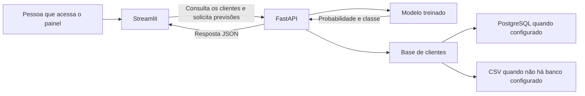

# Permanência · Previsão de churn com MLOps

Foi desenvolvido um sistema para estimar a probabilidade de um cliente cancelar
um serviço. Esse cancelamento é chamado de **churn**. A aplicação permite
consultar um cliente pelo código e visualizar a previsão de forma simples.

**[Acessar o painel publicado](https://mlopsjose.streamlit.app/)**

No painel, basta informar um `customerID` ou selecionar um dos clientes de
exemplo e clicar em **Consultar**. Foi utilizada uma base de **7.043 clientes**.
A previsão representa uma estimativa do modelo, não uma confirmação de que o
cancelamento acontecerá.

## Como o sistema funciona

Foi realizada a separação entre a interface, o serviço de previsão e o
armazenamento dos clientes. A **fonte consultada pelo painel é a FastAPI**.



1. O código do cliente é informado na tela.
2. Os dados cadastrados são obtidos pela FastAPI.
3. O modelo treinado calcula a probabilidade de cancelamento.
4. A API devolve a probabilidade, a classe e o limiar utilizado.
5. O resultado é apresentado no painel, junto da resposta original em JSON.

Quando o PostgreSQL está configurado, foi definido um usuário somente de
leitura para as consultas da API. Sem banco configurado, o CSV incluído na
imagem é lido pelo próprio backend. Nos dois casos, o painel utiliza a FastAPI.
Se um banco configurado ficar indisponível, é exibido um erro, sem trocar a
origem dos dados silenciosamente.

## O que aparece no resultado

Foi criada uma apresentação com destaque para a interpretação da previsão,
acompanhada dos valores recebidos da API.

| Informação | Explicação |
| --- | --- |
| Probabilidade de churn | Chance estimada de cancelamento do serviço. |
| Probabilidade de permanência | Valor complementar à probabilidade de churn. |
| Limiar da decisão | Ponto usado para transformar a probabilidade em uma classe. O padrão é 50%. |
| Classe 0 | Tendência de permanência. |
| Classe 1 | Tendência de cancelamento, quando a probabilidade é maior ou igual ao limiar. |
| Fonte da inferência | FastAPI, responsável por executar a previsão com o modelo. |
| Resposta JSON | Dados originais devolvidos pela API, disponíveis para conferência e download. |

Por exemplo, uma probabilidade de churn de 72% resulta na classe 1 quando o
limiar é 50%. Uma probabilidade de 28% resulta na classe 0. Esses números são
apenas exemplos de interpretação, não resultados de um cliente específico.
O modelo estima cancelamento do serviço; não foi desenvolvido para prever
inadimplência ou garantir pagamentos futuros.

## Ferramentas utilizadas

| Ferramenta | Papel no projeto |
| --- | --- |
| Python e scikit-learn | Preparação dos dados, treinamento e execução do modelo. |
| Pandera | Validação da estrutura e dos valores da base. |
| DVC | Controle de versão do arquivo de dados utilizado no treinamento. |
| MLflow | Registro dos experimentos, métricas, versões e modelo selecionado. |
| FastAPI | Disponibilização dos clientes e das previsões por HTTP. |
| Streamlit | Construção da interface de consulta e apresentação do resultado. |
| Docker e Compose | Execução da API, do painel e do banco em contêineres. |
| PostgreSQL | Armazenamento persistente da carteira de clientes. |
| Render | Hospedagem da API na nuvem. |
| Streamlit Community Cloud | Hospedagem da interface no endereço público do projeto. |

O banco do MLflow continua separado da carteira de clientes: os experimentos
utilizam SQLite no ambiente local, enquanto o PostgreSQL foi preparado para os
dados consultados pela aplicação.

## Treinamento e resultado registrado

Foi realizada a comparação de **22 configurações**, incluindo um modelo de
referência, regressão logística, Random Forest e HistGradientBoosting.
A escolha foi feita pela média de ROC AUC em uma validação cruzada de cinco
partes, utilizando somente os dados de treinamento. O conjunto de teste foi
utilizado após a escolha do modelo.

Foi utilizada uma divisão estratificada de **75% para treinamento** e
**25% para teste**, com semente 2026. O modelo selecionado foi uma
**regressão logística**, registrada no MLflow como `churn-champion`, versão 1,
com o alias `champion`.

| Resultado | Valor |
| --- | --- |
| Clientes na base | 7.043 |
| Registros de treinamento | 5.282 |
| Registros de teste | 1.761 |
| ROC AUC na validação cruzada | 0,8265 |
| ROC AUC no teste | 0,8467 |
| Acurácia no teste | 77,91% |
| F1 no teste | 0,6212 |

Esses valores foram extraídos de [reports/selection.json](reports/selection.json).
ROC AUC mede a capacidade de distinguir as classes ao variar o limiar; não
significa que 84,67% de todas as previsões estejam corretas. A taxa de acertos
nesse teste é representada pela acurácia.

O pipeline exportado inclui o tratamento dos dados e o classificador.
Ele é carregado pela API para realizar as previsões, sem necessidade de treinar
novamente a cada consulta.

## O que é o Render e por que foi utilizado

O **Render é uma plataforma de hospedagem em nuvem** que permite publicar
aplicações a partir de um repositório Git ou de uma imagem Docker. Foi utilizado
para disponibilizar a FastAPI pela internet, com endereço HTTPS e execução fora
do computador local. A plataforma também oferece PostgreSQL gerenciado.
[Documentação do Render](https://render.com/docs/web-services)

Foi escolhida essa alternativa para dar continuidade à demonstração enquanto
a implantação na AWS não era concluída. Com o Render, foi possível aproveitar
o Dockerfile e o modelo já preparados, reduzindo as etapas de configuração de
um servidor. A interface foi mantida no Streamlit Community Cloud.

Na preparação da alternativa AWS, foram encontradas dificuldades para concluir
a configuração e a publicação do ambiente. Como a mensagem exata da falha não
foi preservada, não foi confirmada uma causa técnica específica. O erro
`OptInRequired` é tratado no guia como uma possibilidade de diagnóstico, não
como uma causa comprovada desta entrega.

O template EC2 e os scripts AWS foram mantidos para uma implantação futura.
A alternativa Render utiliza outra forma de hospedagem e não representa uma
EC2 em funcionamento.

## Hospedagem: o que foi realizado e o que está preparado

| Parte | Situação |
| --- | --- |
| Painel Streamlit | Foi publicado no endereço `mlopsjose.streamlit.app`. |
| API FastAPI | Foi adotada a hospedagem no Render; as novas versões dependem da conclusão do deploy após o envio ao GitHub. |
| Docker com PostgreSQL | Foi implementado e validado localmente, com volume persistente e usuário de leitura. |
| PostgreSQL no Render | Foram preparados o importador e o roteiro de configuração. A criação do banco e suas credenciais são etapas da conta Render. |
| AWS EC2 | Foram preparados o template e o bootstrap. A implantação na conta AWS não foi concluída. |

O Docker executado no computador para quando o PC é desligado. Já os serviços
publicados no Render e no Streamlit Cloud executam nos servidores dessas
plataformas. O acesso online não depende do computador local ligado.

No plano gratuito, o serviço web do Render pode suspender após 15 minutos sem
tráfego e demorar para responder ao primeiro acesso seguinte. O PostgreSQL
gratuito do Render expira após 30 dias. Portanto, o plano gratuito foi
considerado para demonstração, com atenção a esses limites.
[Limitações oficiais](https://render.com/docs/free)

## Executar em outro computador

Foi utilizado Python 3.13. Para iniciar uma instalação nova, são necessários
Git, uv e Docker com Compose v2. Execute os comandos na pasta do repositório:

```powershell
git clone https://github.com/Pedro-M-R/ml-ops.git
cd ml-ops
uv sync --locked --python 3.13
uv run python scripts/preparar_postgres.py
docker compose -p churn -f docker-compose.yml -f compose.postgres.yml up -d --build --wait --wait-timeout 300 api dashboard
```

O script gera senhas locais, sem exibi-las, e o banco importa o CSV na primeira
inicialização do volume. O modelo selecionado já acompanha o repositório.

- Painel: [http://127.0.0.1:8501](http://127.0.0.1:8501)
- Documentação da API: [http://127.0.0.1:8000/docs](http://127.0.0.1:8000/docs)
- Verificação da aplicação e do banco: [http://127.0.0.1:8000/ready](http://127.0.0.1:8000/ready)

Se a aplicação já estiver rodando no Docker Desktop, deve ser utilizado o grupo
existente. Os comandos acima são para uma instalação nova; duas instalações
não podem ocupar as mesmas portas ao mesmo tempo.

Para encerrar a instalação criada com `-p churn`, preservando o banco:

```powershell
docker compose -p churn -f docker-compose.yml -f compose.postgres.yml down
```

O volume mantém os registros entre recriações dos contêineres. A opção `down -v`
remove os volumes e seus dados; ela não faz parte do procedimento normal de atualização.

## Consultas disponíveis na API

| Método e rota | Finalidade |
| --- | --- |
| `GET /health` e `GET /ping` | Conferir se a API iniciou e carregou o modelo. |
| `GET /ready` | Conferir o modelo e, quando configurado, o PostgreSQL com clientes. |
| `GET /customers` | Consultar clientes em páginas de até 1.000 registros. |
| `GET /customers/{customer_id}` | Buscar o perfil de um cliente pelo código. |
| `POST /predict` | Receber clientes e devolver probabilidades e classes. |
| `POST /invocations` | Realizar inferência em formatos compatíveis com o MLflow. |
| `GET /docs` | Abrir a documentação interativa dos contratos da API. |

## Conferir a implementação

Foi preparada uma suíte de testes para validação de dados, pré-processamento,
treinamento, API e interface. Também foram realizadas verificações com Docker
e PostgreSQL, incluindo a importação dos 7.043 clientes, a preservação dos dados
e a restrição de escrita do usuário da API.

```powershell
uv run pytest -q
docker compose -p churn -f docker-compose.yml -f compose.postgres.yml exec -T api python scripts/verificar_postgres.py
```

O segundo comando deve utilizar o mesmo nome de projeto usado ao subir os
serviços. Os testes locais não substituem a conferência do deploy na plataforma.

## Organização e guias

| Caminho | Conteúdo |
| --- | --- |
| `src/churn/` | Preparação dos dados, treinamento, API e painel. |
| `frontend/` | Entrada da interface publicada e cópia da base para distribuição. |
| `deployment/` | Pipeline e modelo selecionados para inferência. |
| `deploy/postgres/` | Scripts de inicialização do PostgreSQL em Docker. |
| `aws/` | Template CloudFormation e inicialização da EC2. |
| `scripts/` | Importação, empacotamento, verificação e publicação. |
| `reports/` | Métricas e registros das verificações realizadas. |
| `tests/` | Testes automatizados do projeto. |

- [Relato explicativo da implementação e da escolha do Render](docs/relato_projeto.md)
- [Publicação da API e do painel](docs/deploy_render_streamlit.md)
- [PostgreSQL no Render](docs/deploy_render_postgres.md)
- [Docker e PostgreSQL local](docs/postgres.md)
- [Alternativa AWS e diagnóstico de configuração](docs/deploy_aws.md)
- [Execução do treinamento e da API](docs/guia_execucao.md)
- [Histórico dos exercícios anteriores](docs/historico_exercicios.md)
