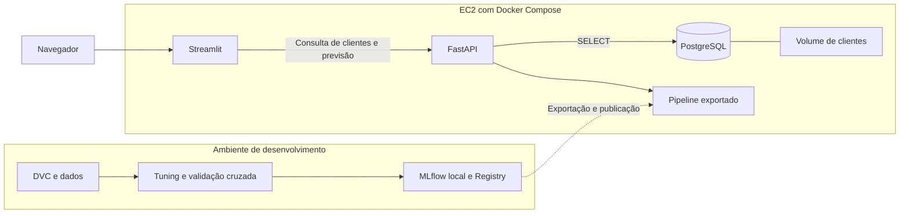

# Permanência: apresentação por ferramenta e etapa

Roteiro para apresentar pelo GitHub, organizado por **o que foi feito em cada ferramenta, como foi feito e por que foi utilizado**. Os tópicos servem de apoio à fala e os links permitem mostrar a implementação.

Para uma fala curta que abrange o projeto inteiro, use o [roteiro completo](apresentacao_projeto.md). O [mapa do repositório](mapa_repositorio.md) explica cada pasta e arquivo da listagem do GitHub.

## Introdução ao projeto

- **O que é:** o Permanência utiliza aprendizado de máquina para estimar a chance de um cliente cancelar um serviço, o chamado churn.
- **Base utilizada:** 7.043 clientes. A proposta foi desenvolver o modelo e organizar seu uso em uma aplicação consultável pelo código do cliente.
- **Recorte:** evolução a partir do MLflow até a aplicação publicada na AWS, conforme o histórico de 20/09 a 15/11/2026, dos commits `1816605` a `547545c`.
- **O que o modelo estima:** cancelamento do serviço, não inadimplência. A probabilidade é uma estimativa do modelo e não uma garantia sobre o comportamento individual.
- **Como interpretar os motivos:** as decisões de hospedagem estão documentadas no projeto; as demais justificativas explicam tecnicamente a implementação, sem atribuir ao autor uma intenção que não foi registrada.

## Navegação por ferramenta e etapa

1. [MLflow: experimentos, Registry e exportação](#1-mlflow-experimentos-registry-e-exportação)
2. [Git, DVC e uv: dados, código e ambiente](#2-git-dvc-e-uv-dados-código-e-ambiente)
3. [Scikit-learn: pipeline de pré-processamento](#3-scikit-learn-pipeline-de-pré-processamento)
4. [Scikit-learn: treinamento e validação cruzada](#4-scikit-learn-treinamento-e-validação-cruzada)
5. [Modelos: comparação e escolha da regressão logística](#5-modelos-comparação-e-escolha-da-regressão-logística)
6. [Avaliação: métricas, erros e limiar](#6-avaliação-métricas-erros-e-limiar)
7. [FastAPI: serviço de consulta e previsão](#7-fastapi-serviço-de-consulta-e-previsão)
8. [Streamlit: painel e melhorias nas consultas](#8-streamlit-painel-e-melhorias-nas-consultas)
9. [PostgreSQL: armazenamento e persistência dos clientes](#9-postgresql-armazenamento-e-persistência-dos-clientes)
10. [Docker Compose: organização da execução](#10-docker-compose-organização-da-execução)
11. [Render: etapa intermediária de hospedagem](#11-render-etapa-intermediária-de-hospedagem)
12. [AWS: publicação e ajustes na EC2](#12-aws-publicação-e-ajustes-na-ec2)
13. [Testes: verificações e limites da entrega](#13-testes-verificações-e-limites-da-entrega)
14. [Funcionamento completo](#14-funcionamento-completo)
15. [Resumo das decisões](#15-resumo-das-decisões)
16. [Perguntas para a apresentação](#16-perguntas-para-a-apresentação)

## 1. MLflow: experimentos, Registry e exportação

- **O que foi feito:** o treinamento passou a registrar parâmetros, métricas e artefatos no experimento `churn` do MLflow.

- **Como foi feito:** o código abre uma execução com `mlflow.start_run()`, registra configurações com `log_params()` e resultados com `log_metrics()`. O modelo é salvo com `mlflow.sklearn.log_model()`, acompanhado de assinatura e exemplo de entrada. Na primeira implementação, o encoder foi salvo separadamente em `preprocessing/encoder.pkl`.

- No tuning posterior, existe uma execução principal e uma execução filha para cada candidato. Os registros incluem as métricas por fold, suas médias e seus desvios, além dos relatórios e do código utilizado.

- **Por que foi feito:** um arquivo de modelo isolado não explica quais parâmetros e dados produziram aquele resultado. O MLflow permite consultar as execuções, compará-las e recuperar os artefatos associados.

- O projeto utiliza MLflow 3.x, serialização com `cloudpickle` e a API `name=` no registro dos modelos.

**Onde mostrar no Git:** [model.py](../src/churn/model.py), [tracking.py](../src/churn/tracking.py) e [tuning.py](../src/churn/tuning.py).

### Registro e exportação do modelo escolhido

- **O que foi feito:** o pipeline completo foi registrado no MLflow como `churn-champion`, versão `1`, com alias `champion`, e exportado para uso pela aplicação.

- **Como foi feito:** depois do ajuste, `mlflow.register_model()` cria a versão. O código recarrega o modelo do Registry e o artefato exportado e compara suas probabilidades com as do modelo em memória nos 1.761 registros de teste. O alias é definido depois dessas verificações.

- O artefato exportado inclui o pipeline, o código necessário às transformações, a assinatura, um exemplo de entrada e as dependências. O caminho fica registrado em `reports/selection.json`.

- **Por que foi feito:** o Registry identifica a versão selecionada, e a exportação permite distribuir um modelo pronto. A aplicação não precisa refazer o treinamento nem acessar o histórico local dos experimentos a cada consulta.

- **Distinção importante:** a API carrega por padrão o **caminho exportado** indicado em `selection.json`. Trocar o alias `champion` no Registry, sozinho, não atualiza a API publicada. É preciso distribuir o novo artefato e atualizar a referência utilizada na execução.

**Onde mostrar no Git:** [tuning.py](../src/churn/tuning.py), [selection.json](../reports/selection.json) e `selected_path()` em [deploy.py](../src/churn/deploy.py).

- **Verificação da exportação:** as probabilidades do modelo original foram comparadas com as do modelo recarregado do Registry e do artefato exportado nos 1.761 registros de teste. Essa comparação confirmou que as versões reproduziam as previsões dentro da tolerância numérica verificada. O histórico MLflow continua local; a API publicada utiliza o pipeline exportado e não precisa consultar esse histórico para prever.

## 2. Git, DVC e uv: dados, código e ambiente

- **O que foi feito:** cada treino passou a identificar a versão dos dados e do código.

- **Como foi feito:** o projeto lê o MD5 do ponteiro DVC e compara esse valor com o hash do CSV utilizado. Se os valores divergirem, o treinamento é interrompido. Também registra as tags `data_md5`, `git_commit` e `git_dirty`.

- O tuning complementa essa identificação com um SHA-256 do código Python, uma cópia dos fontes, o arquivo `uv.lock` e o relatório da divisão treino/teste.

- **Por que foi feito:** mudanças nos dados, nas dependências ou no código podem alterar os resultados. Essas informações ajudam a explicar e reproduzir uma execução específica.

| Ferramenta | Papel no projeto |
| --- | --- |
| Git | Versionar código e configurações. |
| DVC | Identificar a versão do arquivo de dados. |
| MLflow | Relacionar execuções, parâmetros, métricas e artefatos. |
| `uv.lock` | Fixar as versões resolvidas das dependências. |

- O tracking atual utiliza **SQLite local**, com artefatos em `mlartifacts`. O caminho absoluto evita criar históricos diferentes ao executar comandos a partir de outras pastas. Esse arranjo oferece um backend SQL local com pouca administração.

- **Ponto para explicar:** o relatório do modelo escolhido registra `git_dirty=true`. Isso significa que havia alterações locais ainda não incluídas no commit informado. O snapshot e o hash do código complementam a rastreabilidade daquela execução.

**Onde mostrar no Git:** [lineage.py](../src/churn/lineage.py), [model.py](../src/churn/model.py), [tracking.py](../src/churn/tracking.py) e [selection.json](../reports/selection.json).

- **O que foi feito com uv:** a instalação utiliza o arquivo `uv.lock` para fixar as versões resolvidas das dependências. Com `uv sync --locked`, é possível preparar um ambiente novo sem copiar a pasta `.venv` de outro computador.

## 3. Scikit-learn: pipeline de pré-processamento

- **O que foi feito:** a preparação dos dados passou a acompanhar o classificador em um único pipeline do scikit-learn.

- **Como foi feito:**

| Etapa | Implementação | Motivo técnico |
| --- | --- | --- |
| Conversão numérica | `RawFeatures` converte os campos numéricos. | Tratar as entradas de maneira consistente. |
| Números ausentes | Imputação pela mediana. | Permitir previsão com números ausentes. A mediana é menos sensível a valores extremos que a média. |
| Escala numérica | `StandardScaler`. | Colocar variáveis em escala comparável para o modelo regularizado. |
| Categorias ausentes | Imputação pela categoria mais frequente. | Preencher ausências no pré-processamento. |
| Categorias em números | `OneHotEncoder(handle_unknown="ignore")`. | Representar categorias e tolerar valores inéditos na inferência. |
| Classificação | Estimador selecionado ao final. | Aplicar o modelo às features preparadas. |

- **Por que foi feito:** o pipeline mantém a mesma preparação no treinamento e na previsão. Durante a validação cruzada, cada fold aprende imputação, escala e categorias somente a partir de sua parte de treino. Isso evita que essas transformações aprendam informações da parte usada para validar.

- `customerID` não entra no treinamento porque identifica o cliente. `Churn` é a resposta que o modelo deve aprender a estimar e também fica fora das entradas.

**Onde mostrar no Git:** [pipeline.py](../src/churn/pipeline.py) e a construção de `X` e a chamada de `cross_validate()` em [tuning.py](../src/churn/tuning.py).

## 4. Scikit-learn: treinamento e validação cruzada

- **O que mudou:** o grid inicial de Random Forest deu lugar a uma comparação mais ampla, com seleção por validação cruzada nos dados de treino.

| Aspecto | Implementação inicial | Fluxo atual de seleção |
| --- | --- | --- |
| Candidatos | Nove configurações de Random Forest. | 21 configurações e um baseline. |
| Comparação | O grid comparava resultados no teste. | Cinco folds de validação cruzada dentro do treino. |
| Pré-processamento | Encoder separado do classificador. | Transformações e classificador no mesmo pipeline. |
| Teste | Participava da comparação dos candidatos. | Avaliação depois de congelar a escolha. |

- **Como foi feito:** `run_tuning()` reserva 25% da base para teste com divisão estratificada e semente `2026`. Os outros 75% passam por `StratifiedKFold`, com cinco partes. O código escolhe o candidato pela maior ROC-AUC média da validação cruzada e só depois avalia o vencedor no teste.

### Como explicar os cinco folds

1. Os 5.282 registros de treino são divididos em cinco partes, mantendo a proporção das classes.
2. Em cada rodada, o candidato aprende com quatro partes e é avaliado na parte restante.
3. O processo se repete até todas as partes terem servido para avaliação.
4. O código calcula a média das métricas das cinco rodadas e compara os candidatos.
5. O vencedor é ajustado nos 5.282 registros de treino e somente depois é avaliado nos 1.761 registros de teste.

- **Por que cinco divisões ajudam:** o resultado passa a considerar diferentes partes de validação, reduzindo a dependência de uma única separação. O pré-processamento também é aprendido novamente dentro de cada rodada, somente com sua parte de treino.

- **Por que foi feito:** usar o teste para escolher configurações faz esse conjunto participar indiretamente do desenvolvimento do modelo. A separação atual preserva uma avaliação final que não orienta o ranking dos candidatos. A estratificação mantém a proporção das classes nas divisões.

- **Importante para a demonstração:** `churn-tune` executa o fluxo atual. O `dvc repro` legado ainda produz `models/model.pkl`; ele não substitui a seleção e a exportação do champion.

**Onde mostrar no Git:** [experiments.py](../src/churn/experiments.py), [tuning.py](../src/churn/tuning.py), [dvc.yaml](../dvc.yaml) e [histórico dos exercícios](historico_exercicios.md).

## 5. Modelos: comparação e escolha da regressão logística

- **O que foi feito:** foram comparados 22 candidatos, usando 5.282 registros de treino. Os 1.761 registros restantes ficaram reservados para o teste.

| Família | Quantidade | Parâmetros comparados |
| --- | ---: | --- |
| Baseline | 1 | `DummyClassifier(strategy="prior")`. |
| Regressão logística | 6 | `C`: 0,1, 1 e 10; `class_weight`: `None` e `balanced`. |
| Random Forest | 9 | `n_estimators`: 100, 200 e 500; `max_depth`: `None`, 8 e 16. |
| HistGradientBoosting | 6 | `learning_rate`: 0,05 e 0,1; `max_leaf_nodes`: 7, 15 e 31. |

- **Como foi feito:** cada candidato passou pelos cinco folds. Isso corresponde a **110 ajustes durante a validação cruzada**, além do ajuste final do vencedor. O código registrou ROC-AUC, average precision, acurácia, precisão, recall, F1 e tempo de ajuste.

- **Por que comparar essas famílias:** a comparação reúne um modelo linear regularizado, duas famílias baseadas em árvores e uma referência simples. O baseline ajuda a avaliar se os candidatos acrescentam capacidade de discriminação. Essa é a interpretação técnica do conjunto implementado; a busca não abrange todos os algoritmos possíveis.

### Por que a regressão logística foi escolhida

| Melhor configuração de cada família | ROC-AUC média na CV | Desvio entre folds |
| --- | ---: | ---: |
| Regressão logística | **0,826544** | 0,015907 |
| HistGradientBoosting | 0,826485 | 0,014236 |
| Random Forest | 0,820519 | 0,015416 |
| Baseline | 0,500000 | 0,000000 |

- O código ordena os candidatos pela **maior ROC-AUC média**. Venceu a regressão logística com `C=0,1`, `class_weight=None` e regularização L2, padrão do estimador utilizado.

- `C` controla inversamente a força da regularização: valores menores aplicam mais regularização. `class_weight=None` indica que o estimador não recebeu pesos automaticamente balanceados por classe.

- **Por que usar ROC-AUC:** ela avalia a capacidade de ordenar as duas classes considerando diferentes limiares. A acurácia, sozinha, poderia esconder uma baixa identificação da classe de interesse. As outras métricas também foram registradas para interpretar o comportamento.

- **Limite da escolha:** a vantagem para o segundo colocado foi de aproximadamente **0,000059**. É uma diferença muito pequena, sem teste formal que demonstre superioridade estatística. A simplicidade da regressão logística é uma vantagem adicional, mas não foi a regra automática de seleção. A ROC-AUC também não mede diretamente o retorno financeiro de uma campanha de retenção.

**Onde mostrar no Git:** [comparison.csv](../reports/comparison.csv), [selection.json](../reports/selection.json) e [tuning.py](../src/churn/tuning.py).

- **Como explicar o baseline:** o `DummyClassifier(strategy="prior")` estima probabilidades pela frequência das classes no treino, sem aprender relações entre as características e o churn. Ele oferece uma referência simples para avaliar a capacidade de discriminação dos outros candidatos. Os 22 candidatos são configurações das famílias comparadas, e não 22 algoritmos diferentes.

- **Como explicar a regularização L2:** ela penaliza coeficientes grandes, ajudando a limitar o ajuste do modelo aos dados de treinamento. Com `C=0.1`, essa penalização é maior do que com os valores 1 e 10 também testados. A opção `class_weight=None` venceu entre as configurações avaliadas e indica que o estimador não recebeu pesos automaticamente balanceados por classe.

## 6. Avaliação: métricas, erros e limiar

- **O que foi feito:** depois da seleção, o vencedor foi ajustado no conjunto de treino e avaliado nos 1.761 registros de teste.

| Métrica | Resultado | Significado |
| --- | ---: | --- |
| ROC-AUC | **0,8467** | Capacidade de ordenar as classes ao variar o limiar. |
| Acurácia | **77,91%** | Proporção total de classificações corretas. |
| Precisão | **70,26%** | Proporção de churn real entre os alertas de churn. |
| Recall | **55,67%** | Proporção dos churns reais identificada pelo modelo. |
| F1 | **0,6212** | Média harmônica entre precisão e recall. |
| Average precision | **0,7142** | Resumo do comportamento de precisão e recall ao variar o limiar. |

### Matriz de confusão no limiar 0,5

| Classe real | Prevê permanência | Prevê churn |
| --- | ---: | ---: |
| Permanência | 1.053 | 135 |
| Churn | 254 | 319 |

- **Como interpretar:** o modelo identificou 319 dos 573 churns reais. Outros 254 ficaram abaixo do limiar e não receberam alerta. Entre os clientes sem churn, 135 receberam alerta.

- **Por que mostrar os erros:** as contagens ajudam a entender o impacto da classificação. Uma campanha precisa considerar tanto clientes em risco que não foram identificados quanto contatos feitos com clientes que permaneceriam.

- O padrão é classificar como churn quando a probabilidade é **maior ou igual a 0,5**. A API permite outro limiar, mas o painel atual fixa esse valor. O projeto ainda não definiu o melhor limiar por custo de contato, receita recuperada ou objetivo de retenção.

**Onde mostrar no Git:** [selection.json](../reports/selection.json), [evaluate.py](../src/churn/evaluate.py) e `THRESHOLD` em [dashboard.py](../src/churn/dashboard.py).

- **Como explicar a precisão e o recall:** foram 454 alertas, dos quais 319 correspondiam a churn real. A precisão é 319 dividido por 454, ou 70,26%. Havia 573 churns reais; como 319 receberam alerta, o recall é 319 dividido por 573, ou 55,67%.

- **Distinção entre métrica e limiar:** a acurácia, a precisão, o recall e o F1 apresentados consideram o corte de 50%. A ROC-AUC considera diferentes limiares, e não apenas o corte de 0,5. Reduzir o limiar tende a aumentar a quantidade de alertas e a captura de churn, com possível aumento dos falsos positivos. O valor atual ainda precisa ser avaliado pelos custos e pelo objetivo da campanha.

## 7. FastAPI: serviço de consulta e previsão

- **O que foi feito:** o modelo passou a ser acessível por um serviço HTTP, com contratos de entrada e saída.

- **Como foi feito:** a FastAPI usa modelos Pydantic para validar as requisições. No ciclo de inicialização, carrega o pipeline exportado com `mlflow.pyfunc.load_model()`. Esse objeto permanece em memória para atender as consultas.

| Rota | Função |
| --- | --- |
| `POST /predict` | Receber clientes e retornar probabilidade de churn, classe e limiar. |
| `POST /invocations` | Aceitar os formatos `dataframe_split` e `dataframe_records` e retornar as duas probabilidades por linha. |
| `GET /customers` | Listar clientes com paginação. |
| `GET /customers/{id}` | Buscar o cadastro de um cliente. |
| `GET /health` e `GET /ping` | Confirmar que a aplicação carregou o modelo. |
| `GET /ready` | Verificar também a disponibilidade de uma carteira não vazia quando o banco está configurado. |
| `GET /docs` | Disponibilizar a documentação interativa OpenAPI. |

- **Por que FastAPI:** a implementação centraliza a inferência, define tipos e limites e disponibiliza documentação a partir dos schemas. A interface passa a consumir um contrato em vez de executar uma cópia independente do modelo.

- As requisições aceitam até **1.000 clientes por lote**. O código rejeita entradas incompatíveis e confere se o modelo devolveu duas probabilidades válidas por cliente. Um ID inexistente retorna `404`; falhas na base retornam `503`, sem mostrar credenciais.

**Onde mostrar no Git:** [api.py](../src/churn/api.py), [deploy.py](../src/churn/deploy.py), [test_api.py](../tests/test_api.py) e [api_verification.json](../reports/api_verification.json).

## 8. Streamlit: painel e melhorias nas consultas

- **O que foi feito:** foi criada a interface Permanência, com consulta pelo código cadastrado, apresentação das probabilidades e classificação da carteira em lote.

- **Como foi feito:** o Streamlit busca o perfil pela FastAPI, envia esse perfil para `/predict` e apresenta a resposta recebida. A tela mostra a chance de cancelar, a chance de permanecer, a classe e o limiar. Também permite conferir os dados usados, visualizar o JSON original e baixar resultados.

- **Por que Streamlit:** a interface foi construída no ambiente Python do projeto e facilita a consulta e a apresentação dos resultados. A separação mantém o cálculo centralizado na FastAPI e evita que o painel precise conhecer a senha do banco ou carregar outro modelo.

- **Por que consultar pelo ID:** os dados do cliente já estão cadastrados. Usar o código evita preencher manualmente todas as características. Um código desconhecido gera uma mensagem, sem inventar informações para produzir uma previsão.

### Alterações para reduzir trabalho desnecessário

| Mudança | Como funciona | Por que foi feita |
| --- | --- | --- |
| Prévia da carteira | A abertura recebe quatro exemplos e a contagem total. | Evitar baixar toda a base antes de uma consulta individual. |
| Consulta direta | O código do cliente vai para `/customers/{id}`. | Buscar apenas o cadastro solicitado. |
| Carteira sob demanda | A base completa é recebida ao classificar em lote. | Concentrar o processamento maior na operação que precisa dele. |
| Cache da sessão | Exemplos por até 60 segundos e saúde por até 30 segundos. | Reduzir chamadas repetidas ao navegar pela tela. |
| Preparação do CSV | O backend reaproveita os registros e o índice por ID até o arquivo mudar. | Evitar ler e preparar o mesmo CSV a cada consulta. |
| Espera pela API | Chamadas de dados e previsão admitem até 120 segundos. | Tratar a espera de inicialização na alternativa Render. |

- Cada nova consulta continua buscando o cliente e solicitando uma previsão. O cache de registros do modo CSV **não se aplica às consultas PostgreSQL**. Não há benchmark antes/depois que permita afirmar uma redução percentual de latência.

- **Ponto para a fala:** o alvo do modelo é cancelamento do serviço, não inadimplência. A interface mostra uma estimativa do modelo, sem garantir o comportamento individual do cliente.

**Onde mostrar no Git:** [dashboard.py](../src/churn/dashboard.py), [dashboard_client.py](../src/churn/dashboard_client.py) e [frontend/streamlit_app.py](../frontend/streamlit_app.py).

## 9. PostgreSQL: armazenamento e persistência dos clientes

- **O que foi feito:** a carteira passou a ser armazenada no PostgreSQL e consultada pela API, com um usuário somente de leitura.

- **Como foi feito:** o CSV é importado em uma transação na primeira inicialização de um volume vazio. A tabela `public.customers` recebe os atributos dos clientes, tipos numéricos, restrições e chave primária por `customerID`. Um índice sobre `lower(customerID)` permite consulta sem distinguir maiúsculas e impede duplicações nessa forma normalizada.

- A coluna histórica `Churn` é lida durante a importação, mas não entra na tabela final de inferência. A API usa Psycopg e consultas com parâmetros SQL.

- **Por que foi feito:** o banco organiza a carteira em um serviço persistente, enquanto a API mantém o mesmo contrato de consulta para a interface. O CSV continua como origem da carga inicial e alternativa do backend quando não há banco configurado.

### Por que o banco ficou na mesma EC2

- A documentação registra que essa escolha **reaproveitou a infraestrutura existente**, em vez de criar uma segunda máquina. A consequência é que banco, API e painel compartilham recursos e disponibilidade.

### Leitura, senhas e volume

- A API usa `churn_reader`, com permissão `SELECT`, sem privilégios administrativos.
- Um script gera senhas separadas para administração e leitura, sem imprimir os valores. Os arquivos ficam fora do Git e do pacote de publicação.
- O volume `customer_data` conserva a carteira entre recriações dos contêineres. O nome estável do projeto Compose permite reutilizá-lo nas atualizações.
- A carga inicial só ocorre em volume vazio. Substituir o CSV não atualiza automaticamente uma tabela já importada.

- **Limite da persistência:** o volume fica no disco EBS raiz. O template remove esse disco ao encerrar a instância ou excluir a stack. Portanto, é necessário backup fora da instância para preservar dados modificados. O guia descreve esse procedimento, mas não há rotina automática de backup comprovada no projeto.

- **Distinção essencial:** este PostgreSQL guarda **clientes**. O histórico dos experimentos MLflow permanece no **SQLite local**.

**Onde mostrar no Git:** [customers.py](../src/churn/customers.py), [customers.sql](../deploy/postgres/customers.sql), [preparar_postgres.py](../scripts/preparar_postgres.py), [compose.postgres.yml](../compose.postgres.yml) e [guia PostgreSQL](postgres.md).

## 10. Docker Compose: organização da execução

- **O que foi feito:** API, painel e banco passaram a ter uma execução coordenada com Docker Compose. Também foi preparado um pacote transportável com código, dependências e modelo.

- **Como foi feito:**

| Arquivo | Responsabilidade |
| --- | --- |
| `Dockerfile` | Construir a imagem da aplicação, utilizada pela API e pelo painel com comandos diferentes. |
| `Dockerfile.postgres` | Preparar o banco baseado em PostgreSQL 17 e seus scripts de inicialização. |
| `docker-compose.yml` | Definir API, painel e um perfil opcional de treino. |
| `compose.postgres.yml` | Acrescentar banco, volume, secrets e verificações de prontidão. |
| `compose.ec2.yml` | Adaptar a publicação para expor somente a porta do painel. |

- A inicialização respeita a ordem: **banco com carteira disponível, API com modelo e base, depois painel**. Os serviços têm políticas de reinício e rotação dos logs.

- **Por que foi feito:** essa organização reduz diferenças de ambiente e descreve as dependências entre processos. O banco apenas aceitar conexão não garante que a carteira já tenha sido carregada; por isso os healthchecks verificam a prontidão necessária à aplicação.

- O pacote gerado por `scripts/empacotar.py` leva código, `uv.lock`, modelo exportado, relatórios e configurações de execução. Não copia `.venv` nem as senhas locais. O histórico registra instalação em ambiente limpo e **7.043 previsões iguais após realocação**, com diferença máxima de probabilidade igual a zero.

**Onde mostrar no Git:** [Dockerfile](../Dockerfile), [docker-compose.yml](../docker-compose.yml), [compose.postgres.yml](../compose.postgres.yml), [compose.ec2.yml](../compose.ec2.yml), [empacotar.py](../scripts/empacotar.py) e [verification.json](../reports/verification.json).

## 11. Render: etapa intermediária de hospedagem

- **O que foi feito:** a API e o painel foram publicados em serviços separados no Render, antes da conclusão da implantação AWS.

- **Como foi feito:** a API aproveitou o Docker e o modelo exportado. A aplicação passou a respeitar a variável `PORT` da plataforma, e o painel usou a URL pública da API. As configurações e o roteiro de PostgreSQL no Render foram preservados como alternativa.

- **Por que Render:** a documentação registra que a configuração inicial AWS ainda não havia resultado em uma publicação. O Render permitiu disponibilizar a demonstração sem administrar uma EC2 naquele momento.

- A mensagem da dificuldade inicial na AWS não foi preservada. Por isso, não é possível atribuir a essa tentativa uma causa técnica específica. Também existem arquivos de preparação para Streamlit Cloud, mas preparação não comprova publicação nessa plataforma.

## 12. AWS: publicação e ajustes na EC2

- **O que foi feito:** a documentação de 15/11 registra a aplicação na região Ohio, `us-east-2`, com Streamlit, FastAPI e PostgreSQL na mesma EC2.

- **Como foi feito:**

1. O script prepara um pacote com código, modelo e base inicial.
2. Pelo CloudShell, o pacote é enviado a um bucket S3 privado.
3. CloudFormation cria a rede, o security group, as permissões IAM e a EC2.
4. O bootstrap baixa o pacote, instala Docker e inicia os serviços com Compose.
5. O painel recebe acesso pela porta `8501` do IP público.

- **Por que AWS:** manter a demonstração disponível sem depender do computador local ligado. CloudFormation registra a infraestrutura em um arquivo, e o bootstrap automatiza sua preparação.

| Escolha de infraestrutura | Implementação e motivo |
| --- | --- |
| S3 privado | Distribuir o pacote de publicação sem torná-lo público. |
| IAM role da EC2 | Permitir a leitura do pacote sem colocar chaves AWS nos contêineres. |
| Session Manager | Administrar a instância sem abrir uma porta SSH no security group. |
| Rede Docker | Manter API e banco sem portas externas no deploy EC2. |
| Disco gp3 criptografado | Armazenar a aplicação e o volume do banco. |
| IMDSv2 obrigatório | Exigir tokens no acesso aos metadados da instância. |

### Correções necessárias na implantação

- A tentativa final com `t3.medium` foi recusada por elegibilidade do plano da conta. Depois da consulta às opções disponíveis na região, foi utilizada **`c7i-flex.large`, com 4 GiB de memória**. O script e o template passaram a aceitar essa opção e `m7i-flex.large`, mantendo a arquitetura `x86_64` da AMI e do bootstrap.

- Essa é uma decisão da implantação registrada, sem promessa de gratuidade ou de melhor preço atual. O template ainda usa `t3.medium` como padrão, então a opção utilizada depende do parâmetro informado.

- O acesso ao painel também passou de uma restrição ao IP de desenvolvimento para uma regra pública na porta `8501`. A documentação relata teste por outra rede. O template continua parametrizando `AllowedCidr`; a liberação pública foi descrita como ajuste da implantação.

- O modelo exportado acompanha a API. **O servidor de tracking MLflow não foi publicado na EC2.** O IP público pode mudar ao parar e iniciar a máquina.

**Onde mostrar no Git:** [relato do projeto](relato_projeto.md), [render.yaml](../render.yaml), [deploy_aws.py](../scripts/deploy_aws.py), [cloudformation.yaml](../aws/cloudformation.yaml), [bootstrap.sh](../aws/bootstrap.sh) e [guia AWS](deploy_aws.md).

## 13. Testes: verificações e limites da entrega

### O que sustenta os resultados apresentados

| Evidência | O que registra |
| --- | --- |
| [selection.json](../reports/selection.json) | Seleção, métricas finais e comparação de 1.761 previsões após recarga do modelo. |
| [verification.json](../reports/verification.json) | Instalação em ambiente limpo e 7.043 previsões iguais após realocação. |
| [api_verification.json](../reports/api_verification.json) | Chamadas HTTP, contratos de entrada, respostas e tratamento de erros. |
| [verificar_postgres.py](../scripts/verificar_postgres.py) | Procedimento que compara a carteira e as previsões e confirma que a conta da API não pode escrever. |
| [Relato do projeto](relato_projeto.md) e [guia AWS](deploy_aws.md) | Verificações posteriores com Docker/PostgreSQL e publicação com acesso externo. |
| Suíte executada em 16/11/2026 | **182 testes passaram**, com quatro avisos de depreciação/compatibilidade. |

- Os relatórios de hospedagem e painel de 09/11 ainda marcavam deploy não executado. A documentação de 15/11 descreve a publicação posterior. Esses registros representam momentos diferentes do desenvolvimento.

- A revisão da suíte não constitui uma auditoria do servidor AWS ativo. Nesta preparação não houve novo treinamento, implantação ou confirmação atual do endereço público.

### O que ainda precisa evoluir

- Definir o limiar a partir dos custos e do objetivo de retenção.
- Avaliar o modelo em clientes novos e acompanhar mudanças nos dados e no desempenho.
- Automatizar backup e testar restauração fora da instância.
- Acrescentar domínio, HTTPS e controle de acesso conforme o uso pretendido.
- Planejar monitoramento, atualização do modelo e disponibilidade dos serviços.

- O projeto demonstra o fluxo completo de experimento até aplicação publicada. Essas evoluções dizem respeito à continuidade da operação e não devem ser apresentadas como funcionalidades já entregues.

## 14. Funcionamento completo

- **Uma consulta, passo a passo:** o usuário informa o código no painel. O Streamlit busca o cadastro na API. A FastAPI consulta o PostgreSQL e devolve os atributos. O painel envia esses atributos para `/predict`. A API aplica o pipeline carregado e devolve as probabilidades e a classe. O painel apresenta essa resposta.

- O treinamento é uma etapa separada. O modelo não treina de novo a cada consulta, e o MLflow local não precisa participar das requisições da aplicação publicada.

## 15. Resumo das decisões

| Escolha | Por que faz sentido no projeto | Consequência ou limite |
| --- | --- | --- |
| MLflow | Relacionar experimentos, resultados e modelos. | Tracking permanece local. |
| DVC e Git | Identificar dados e código do treinamento. | A execução selecionada tem alterações locais indicadas por `git_dirty`. |
| Pipeline com CV | Selecionar candidatos sem usar o teste e ajustar transformações dentro de cada fold. | A comparação exige mais ajustes durante o treino. |
| Regressão logística | Maior ROC-AUC média entre os candidatos testados. | Diferença mínima para o segundo colocado. |
| Registry e exportação | Identificar a versão escolhida e distribuir um modelo pronto. | A atualização da API exige distribuir o novo artefato. |
| FastAPI | Centralizar validação, consultas e inferência. | A interface depende da disponibilidade do serviço. |
| Streamlit | Oferecer uma interface Python para consultar e interpretar os resultados. | O cálculo continua na API. |
| PostgreSQL | Guardar a carteira para consultas persistentes com conta de leitura. | Exige credenciais, atualização de dados e backup. |
| Docker Compose | Organizar os serviços e a ordem de inicialização. | Não fornece, sozinho, alta disponibilidade. |
| Render | Permitir a publicação enquanto a AWS estava pendente. | Requer comunicação entre serviços hospedados separadamente. |
| Uma EC2 | Reaproveitar infraestrutura e executar sem o PC local. | Os três serviços compartilham recursos e disponibilidade. |

## 16. Perguntas para a apresentação

<strong>Por que MLflow se o projeto já utiliza Git?</strong>

- Git guarda versões dos arquivos. MLflow guarda execuções e relaciona parâmetros, métricas e modelos. DVC identifica os dados. Essas informações se complementam para explicar de onde veio um resultado.

<strong>Por que usar validação cruzada e ainda reservar teste?</strong>

- A validação cruzada compara candidatos dentro do treino. O teste avalia o modelo depois de congelar a escolha. Assim, o resultado final não participa do ranking dos candidatos.

<strong>A regressão logística foi escolhida porque é mais simples?</strong>

- O critério automático foi a maior ROC-AUC média de validação cruzada. A simplicidade é uma vantagem técnica adicional. Não houve regra automática de preferência pelo modelo mais simples nem demonstração de superioridade estatística sobre o segundo colocado.

<strong>77,91% de acurácia significa identificar quase todos os cancelamentos?</strong>

- Não. A acurácia considera as duas classes. O recall de churn foi 55,67%: o modelo identificou 319 dos 573 churns reais no limiar 0,5. Essa diferença explica por que é necessário mostrar várias métricas e a matriz de confusão.

<strong>Por que o limiar é 50%?</strong>

- É o padrão implementado. Ainda não existe um estudo de custos que o justifique como melhor decisão para uma campanha. A API aceita outro valor, enquanto o painel atual usa 0,5.

<strong>O modelo treina de novo quando alguém consulta um cliente?</strong>

- Não. A API carrega o pipeline pronto uma vez na inicialização e executa apenas a previsão. O treinamento ocorre separadamente com `churn-tune`.

<strong>O PostgreSQL substituiu o banco do MLflow?</strong>

- Não. O PostgreSQL armazena os clientes consultados pela API. O tracking MLflow continua em SQLite local, com seus artefatos no ambiente de desenvolvimento.

<strong>Trocar o alias champion muda o modelo publicado automaticamente?</strong>

- Não no fluxo padrão. A API utiliza o artefato exportado indicado em `selection.json`. A atualização precisa distribuir a nova versão para o ambiente de execução.

<strong>Por que Render antes da AWS?</strong>

- O Render permitiu disponibilizar a demonstração enquanto a configuração AWS estava pendente. A tentativa inicial não preservou uma mensagem de erro. A recusa da `t3.medium` por elegibilidade pertence à tentativa final documentada e não deve ser usada para explicar automaticamente o problema inicial.

<strong>Por que uma EC2 e por que c7i-flex.large?</strong>

- A documentação justifica uma EC2 pelo reaproveitamento da infraestrutura. O tipo `c7i-flex.large` foi utilizado depois da recusa da `t3.medium`, conforme as opções elegíveis consultadas naquela conta e região. A escolha manteve 4 GiB e arquitetura x86_64, sem implicar gratuidade ilimitada.

<strong>O volume Docker garante que os dados nunca serão perdidos?</strong>

- Ele conserva a carteira entre recriações dos contêineres. Entretanto, o disco raiz pode ser removido ao encerrar a EC2 ou excluir a stack. Backup fora da instância continua necessário.

### Sequência sugerida para demonstrar pelo GitHub

1. Abrir este roteiro e percorrer a evolução e as decisões principais.
2. Mostrar os números em [selection.json](../reports/selection.json) e o ranking em [comparison.csv](../reports/comparison.csv).
3. Abrir [pipeline.py](../src/churn/pipeline.py) e a seleção em [tuning.py](../src/churn/tuning.py).
4. Mostrar as rotas em [api.py](../src/churn/api.py) e explicar o caminho de uma consulta.
5. Abrir [compose.postgres.yml](../compose.postgres.yml) e [cloudformation.yaml](../aws/cloudformation.yaml) para relacionar a aplicação à execução.
6. Se houver demonstração ao vivo, conferir antes o endereço no [guia AWS](deploy_aws.md), consultar um cliente real e abrir a resposta original da API.

**Fechamento sugerido:** a entrega conectou um treinamento rastreável a uma aplicação consultável. O MLflow organiza os experimentos, a validação cruzada orienta a escolha, o pipeline preserva as transformações e a aplicação disponibiliza o resultado com API, painel e armazenamento persistente.

## Histórico resumido das entregas

| Data | Alteração mais importante | Efeito no projeto |
| --- | --- | --- |
| 20/09 | MLflow, linhagem DVC/Git e grid inicial | Cada experimento passou a guardar sua configuração e seus resultados. |
| 04/10 | Tuning com validação cruzada, Registry e exportação | A seleção passou a preservar o teste e produzir um pipeline pronto para uso. |
| 26/10 | API FastAPI | O modelo passou a receber requisições HTTP com entradas e respostas definidas. |
| 09/11 | Painel Permanência e preparação da hospedagem | A previsão ganhou uma interface de consulta e apresentação dos resultados. |
| 15/11 | PostgreSQL e consultas mais leves | A API passou a consultar uma carteira persistente, com menos trabalho na abertura do painel. |
| 15/11 | Ajustes de instância e publicação na EC2 | A documentação passou a registrar acesso externo sem depender do computador local. |

- **Ideia central para a abertura:** o trabalho passou do treinamento de um modelo para a organização de seu uso por uma aplicação. Isso exigiu controlar a origem dos resultados, definir contratos de previsão e preparar a execução fora do ambiente de desenvolvimento.
