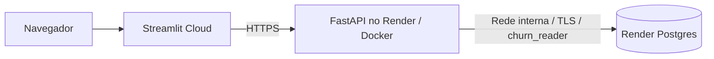

# Publicar API e PostgreSQL no Render

> Alternativa de hospedagem. A implantação principal atual utiliza AWS EC2 com
> Streamlit, FastAPI e PostgreSQL, conforme o [guia AWS](deploy_aws.md).

Nesta alternativa, a API e o PostgreSQL ficam no Render e o painel pode executar
separadamente no Streamlit Cloud ou no próprio Render. Configure os endereços
dos serviços criados para essa instalação. O computador local é utilizado para
enviar o código e importar a carteira; a execução dos serviços ocorre na nuvem.



O PostgreSQL é gerenciado pelo Render. Nesta opção não se executam
`aws/bootstrap.sh`, Docker Compose nem `Dockerfile.postgres` na nuvem.
O Compose local e a entrega EC2 continuam disponíveis no projeto.

## 1. Enviar o projeto atualizado

Na pasta `ml-ops`, execute:

```powershell
uv sync --locked
uv run python scripts/importar_clientes_render.py --check-only
git status --short
git add .
git diff --cached --stat
git commit -m "Integra PostgreSQL local e prepara publicacao no Render"
git push origin main
```

Confira os arquivos antes do commit. `runtime/secrets`, `.env` e `secrets.toml`
são ignorados pelo Git. O script precisa de `frontend/data/churn.csv`, e a API
precisa do modelo em `deployment/` indicado em `reports/selection.json`.
Se houver uma atualização automática da API antes de configurar o banco, ela
continua atendendo às previsões no modo atual; só mude o painel para `api` após a etapa 4.

## 2. Criar o banco no Render

No [painel Render](https://dashboard.render.com/), escolha **New → Postgres**:

| Campo | Valor |
| --- | --- |
| Name | `churn-clientes` |
| Database | `churn` |
| User | `churn_owner` |
| Region | A mesma da API existente; o `render.yaml` usa Virginia |
| PostgreSQL Version | `17` |
| Plan | `Free`, para demonstração temporária |

O plano Free do PostgreSQL expira após 30 dias. Para manter o banco depois desse
prazo, será necessário mudar seu plano. Se já houver um banco gratuito na sua
conta, confira qual projeto o utiliza: o Render permite apenas um banco Free
ativo por workspace. Não exclua o banco de outro projeto para liberar a vaga.
[Limites oficiais](https://render.com/docs/free)

Espere o banco ficar disponível. Abra **Connect** e localize **External Database URL**.
Ela contém as credenciais do proprietário: use-a somente no importador local,
sem enviá-la ao GitHub ou ao chat. Em **Networking**, autorize seu IP público `/32`
para permitir a conexão do computador durante a importação.

## 3. Importar os clientes e criar a conta de leitura

No terminal do seu computador, dentro de `ml-ops`:

```powershell
uv run python scripts/importar_clientes_render.py
```

O script valida o CSV e solicita três entradas ocultas:

1. **External Database URL** copiada do Render.
2. Uma senha de pelo menos 20 caracteres para `churn_reader`.
3. A repetição dessa mesma senha.

O terminal não mostra os caracteres digitados ou colados. Guarde a senha de
leitura para colocá-la no Environment da API. O script não salva as credenciais
em arquivos e conecta usando TLS obrigatório.

A carga cria `public.customers`, importa os 7.043 clientes do CSV e concede
somente leitura ao usuário `churn_reader`. O histórico `Churn` fica fora da tabela
de inferência. Tudo ocorre numa transação: uma falha desfaz essa execução.

Ao concluir, será exibido um resumo com `customers`, `inserted` e `reader`.
Executar novamente insere apenas IDs novos e preserva registros existentes;
também configura a senha de leitura informada. Para trocar essa senha depois,
atualize `CHURN_DB_PASSWORD` na API para o mesmo valor.

Após importar, você pode remover o IP autorizado em Networking para bloquear
conexões externas ao banco. A API continua conectando pela rede interna do Render.

## 4. Conectar a API existente

Abra **sua API atual** no Render, sem criar outra. Em **Environment**, configure:

| Variável | Valor |
| --- | --- |
| `CHURN_DB_HOST` | Hostname **interno** mostrado no banco, como `dpg-...-a` |
| `CHURN_DB_PORT` | `5432` |
| `CHURN_DB_NAME` | Nome real do database mostrado pelo Render; `churn` se seguiu a etapa 2 |
| `CHURN_DB_USER` | `churn_reader` |
| `CHURN_DB_PASSWORD` | Senha de leitura escolhida no importador |
| `CHURN_DB_SSLMODE` | `require` |

Não use `localhost`, `postgres` ou o usuário proprietário nessa configuração.
Se existir `CHURN_DB_PASSWORD_FILE`, remova essa variável: ela pertence ao Docker
local e o Render usa `CHURN_DB_PASSWORD` diretamente.

Confirme que banco e API estão na mesma região. Salve com deploy, ou use
**Manual Deploy → Deploy latest commit**. Se o serviço foi criado manualmente,
configure em **Settings → Health Check Path** o valor `/ready`; o Blueprint
`render.yaml` já contém essa configuração.

Abra, trocando pela URL real da sua API:

```text
https://SUA-API.onrender.com/ready
https://SUA-API.onrender.com/customers?limit=1
```

O primeiro deve retornar `{"status":"ok"}`. O segundo deve retornar `total: 7043`
e um cliente. Se `/ready` responder 503, confira os seis valores de Environment
e se a importação terminou. Não prossiga com a mudança do painel enquanto esses
endereços não funcionarem.

## 5. Configurar seu painel atual

No Streamlit Community Cloud, abra o app **mlopsjose**, em **Settings → Secrets**,
e configure:

```toml
CHURN_API_URL = "https://SUA-API.onrender.com"
CHURN_API_PUBLIC_URL = "https://SUA-API.onrender.com"
CHURN_CUSTOMER_SOURCE = "api"
```

Use a URL base real da API, sem `/docs` ou `/ready`. Salve e reinicie o app.
O código atualizado de `frontend/streamlit_app.py` precisa estar na branch publicada.
Nenhuma credencial de PostgreSQL vai para o Streamlit.

Abra `https://mlopsjose.streamlit.app/`. A tela deve mostrar **Fonte: FastAPI**.
Clique em um cliente de exemplo e confirme a previsão. Os clientes passam a ser
obtidos do banco através da API, mantendo seu endereço atual.
O painel usa a FastAPI por padrão, inclusive sem `CHURN_CUSTOMER_SOURCE` definido.
O PostgreSQL é o armazenamento consultado pelo backend; a tela não conecta ao banco.
Sem `CHURN_DB_HOST`, a FastAPI fornece os registros do CSV incluído na imagem.
Assim, a versão inicial pode usar o CSV no backend enquanto o banco é preparado,
mantendo **Fonte: FastAPI** no painel. Com o hostname configurado, a API exige o
PostgreSQL e retorna erro se ele estiver indisponível, sem trocar silenciosamente a base.

O serviço web Free do Render suspende após 15 minutos sem tráfego. Ao voltar,
a primeira consulta pode demorar. Se a API encerrar por falta de memória, confira
os logs e dimensione seu plano; o modelo usa MLflow e não há garantia de caber
em toda instância gratuita. [Limites do Render](https://render.com/docs/free)

## Opcional: hospedar também o painel no Render

Se quiser um endereço `https://SEU-PAINEL.onrender.com`, crie outro **Web Service**
no mesmo repositório, separado da API, com:

| Campo | Valor |
| --- | --- |
| Runtime | Python |
| Root Directory | Vazio |
| Build Command | `pip install -r frontend/requirements.txt` |
| Start Command | `python -m streamlit run frontend/streamlit_app.py --server.address 0.0.0.0 --server.port $PORT` |
| Health Check Path | `/_stcore/health` |
| `PYTHON_VERSION` | `3.13.2` |
| `CHURN_API_URL` | URL HTTPS da API existente |
| `CHURN_API_PUBLIC_URL` | Mesma URL da API |
| `CHURN_CUSTOMER_SOURCE` | `api` |

O endereço desse novo serviço é fornecido pelo Render, que administra o HTTPS.
Esse caminho não exige EC2 nem configurar Nginx.

Referências: [conexões internas e TLS do PostgreSQL](https://render.com/docs/postgresql-creating-connecting),
[serviços Docker](https://render.com/docs/docker),
[serviços web](https://render.com/docs/web-services) e
[versão do Python](https://render.com/docs/python-version).
