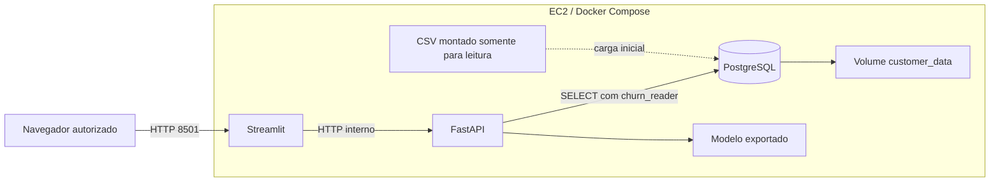

# Clientes no PostgreSQL com Docker e EC2

A referência analisada foi [JoelFarias/Mlops](https://github.com/JoelFarias/Mlops),
commit `6c805a9`. A lógica aproveitada é: importar a carteira no PostgreSQL,
consultá-la pela API com uma conta de leitura e executar a aplicação em Docker
na EC2. O treinamento e o modelo selecionado deste projeto continuam sendo os existentes.

| Parte | Referência | Implementação neste projeto |
| --- | --- | --- |
| Carteira | CSV incorporado na imagem do banco | CSV montado somente para a carga inicial |
| Banco | PostgreSQL em uma segunda EC2 | PostgreSQL em contêiner na mesma EC2 |
| Consulta | API acessa o banco com conta de leitura | `/customers` paginado e `/customers/{id}`, com `churn_reader` |
| Persistência | Volume Docker | Volume `customer_data`, com nome estável no deploy |
| Implantação | Scripts para duas máquinas | CloudFormation existente e bootstrap com Docker Compose |

A escolha de uma EC2 reaproveita a infraestrutura do projeto. Banco, API e painel
compartilham o host e seu ciclo de disponibilidade. Separar o banco futuramente
exigirá uma segunda infraestrutura e configuração de conexão e TLS.



Na EC2 só o painel publica uma porta. A API e o PostgreSQL ficam acessíveis pela
rede Docker. O Security Group existente limita a porta 8501 ao CIDR informado.
O painel recebe os registros pela API; somente a API recebe a senha de leitura.
O backend de experimentos MLflow continua em SQLite: este PostgreSQL armazena clientes.

## Executar localmente

Na pasta `ml-ops`, com Docker Desktop iniciado e Compose 2.24.4 ou superior:

```powershell
uv sync --locked
uv run python scripts/preparar_base_painel.py
uv run python scripts/preparar_postgres.py
docker compose -p churn -f docker-compose.yml -f compose.postgres.yml up -d --build --wait --wait-timeout 300 api dashboard
```

Abra [o painel](http://127.0.0.1:8501) ou [o Swagger](http://127.0.0.1:8000/docs).
A imagem `churn-app:local` é compartilhada pela API e pelo painel. O banco usa
`Dockerfile.postgres`, baseado em PostgreSQL 17. A ordem de subida é banco com
carga concluída, API com modelo e banco disponíveis, depois painel.

```powershell
Invoke-RestMethod http://127.0.0.1:8000/ready
Invoke-RestMethod 'http://127.0.0.1:8000/customers?limit=2&offset=0'
docker compose -p churn -f docker-compose.yml -f compose.postgres.yml exec -T api python scripts/verificar_postgres.py
```

O verificador compara todos os clientes com o CSV, testa as previsões e confirma
que a conta da API não consegue excluir registros. `/health` verifica o modelo;
`/ready` também exige uma carteira não vazia quando o banco está configurado.
Falhas na consulta retornam 503 sem mostrar credenciais; um ID inexistente retorna 404.
As consultas usam parâmetros SQL, preservam IDs textuais e retornam números ausentes
como `null`. O alvo histórico `Churn` não é armazenado na tabela de inferência.

Sem o overlay, `docker compose up --build -d api dashboard` também usa a FastAPI:
nesse caso é a API que lê o CSV incluído na imagem. Com o overlay, a API consulta
o PostgreSQL. A tela mostra **Fonte: FastAPI** em ambos os casos.
A leitura direta do CSV na tela é apenas um modo legado, selecionado explicitamente
com `CHURN_CUSTOMER_SOURCE=csv`. Ao abrir o painel, são recebidos apenas quatro
clientes de exemplo e a contagem total. A consulta individual busca o cadastro
solicitado pela API. A carteira completa só é recebida ao classificar toda a base,
em páginas de até 1.000 clientes, com limite de 50.000 registros.

Os exemplos e a contagem são reaproveitados por até 60 segundos na sessão do
usuário; o estado de saúde, por até 30 segundos. Cada consulta solicita novamente
o cliente e uma previsão à FastAPI. No backend sem PostgreSQL, o CSV é preparado
uma vez em memória e novamente quando o arquivo muda. Consultas ao PostgreSQL
continuam lendo o banco, sem esse cache de registros.

## Senhas, carga inicial e persistência

`scripts/preparar_postgres.py` gera duas senhas aleatórias em `runtime/secrets`:
uma administrativa para o PostgreSQL e outra para `churn_reader`. O script
preserva valores existentes, usa arquivos LF no Windows/Linux e não imprime senhas.
No Linux o diretório é 0700; os arquivos precisam ser legíveis pelo usuário do
PostgreSQL dentro dos contêineres. Os arquivos ficam fora do Git, do contexto da
imagem da aplicação e do ZIP transportável.

O entrypoint importa `frontend/data/churn.csv` para `public.customers` somente
quando o volume está vazio. A carga é transacional e cria chave primária e índice
de ID sem distinção de maiúsculas. A conta da API recebe apenas `USAGE` no schema
e `SELECT` na tabela. O perfil histórico de churn não entra nas entradas do modelo.

Use sempre o mesmo `-p churn` e os mesmos arquivos Compose nas operações:

```powershell
docker compose -p churn -f docker-compose.yml -f compose.postgres.yml ps
docker compose -p churn -f docker-compose.yml -f compose.postgres.yml logs --tail 80 postgres api dashboard
docker compose -p churn -f docker-compose.yml -f compose.postgres.yml down
```

`down` preserva o volume. Recriar a imagem ou substituir o CSV não recarrega a tabela
existente. `down -v` apaga a carteira; não use essa opção para atualizar a aplicação.
Não remova os arquivos de senha enquanto reutiliza o volume: gerar novas senhas
locais não altera as credenciais já armazenadas no PostgreSQL.

Se uma carga inicial falhar, consulte os logs. Um volume parcialmente inicializado
não executa os scripts novamente no próximo boot. Para uma instalação nova sem dados
úteis, corrija a origem e reinicialize apenas o volume dessa instalação; para dados
existentes, restaure um backup em uma instalação separada.

## Deploy e backup na EC2

Siga [o guia de deploy AWS](deploy_aws.md). O pacote inclui os overlays e o SQL.
O bootstrap instala o Compose oficial com versão fixa e verificação SHA-256,
gera as senhas na EC2 e sobe o projeto `churn`, preservando o volume nas atualizações.
As senhas locais não são enviadas para a AWS. Não há credenciais AWS nos contêineres.

No Session Manager, execute:

```bash
cd /opt/churn/churn-portatil
sudo docker compose -p churn -f docker-compose.yml -f compose.postgres.yml -f compose.ec2.yml ps
sudo docker compose -p churn -f docker-compose.yml -f compose.postgres.yml -f compose.ec2.yml exec -T api python scripts/verificar_postgres.py
```

Para produzir um backup lógico no host Linux, sem redirecionar binário no PowerShell:

```bash
sudo install -d -m 700 /opt/churn/backups
sudo sh -c 'umask 077; docker compose -p churn -f docker-compose.yml -f compose.postgres.yml -f compose.ec2.yml exec -T postgres pg_dump -U churn_admin -d churn -Fc > /opt/churn/backups/customers.dump'
```

Copie o backup para armazenamento fora da instância e preserve as senhas em local
seguro. Para ensaiar uma restauração, prepare uma implantação separada e use o seu
projeto Compose como destino; `pg_restore --no-owner --no-acl --clean --if-exists`
restaura o conteúdo, e será necessário conceder novamente `SELECT` a `churn_reader`.
Não restaure sobre a carteira ativa sem planejar a substituição dos dados.

O volume Docker fica no EBS raiz. Ele sobrevive ao reinício dos contêineres e da EC2,
mas o template atual remove esse disco ao excluir a stack ou encerrar a instância.
O bucket com o ZIP contém o CSV inicial, não os registros modificados do banco.
Faça backup antes de encerrar ou substituir a EC2.

Referências: [ordem de inicialização no Compose](https://docs.docker.com/compose/how-tos/startup-order/),
[imagem oficial PostgreSQL](https://hub.docker.com/_/postgres) e
[parâmetros SQL no Psycopg](https://www.psycopg.org/psycopg3/docs/basic/params.html).
